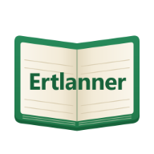
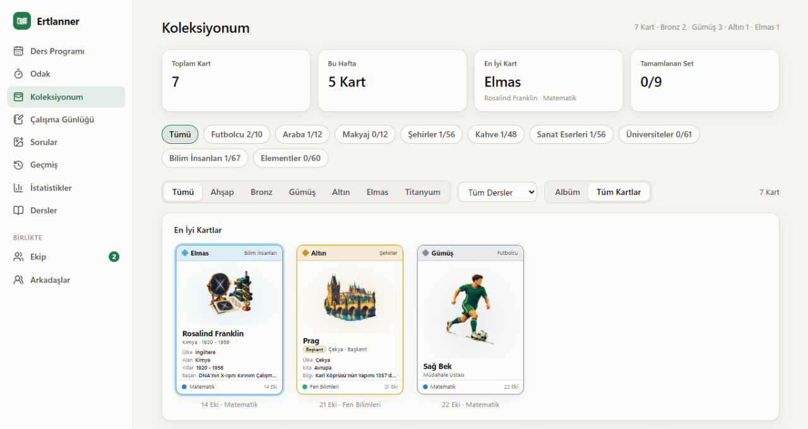
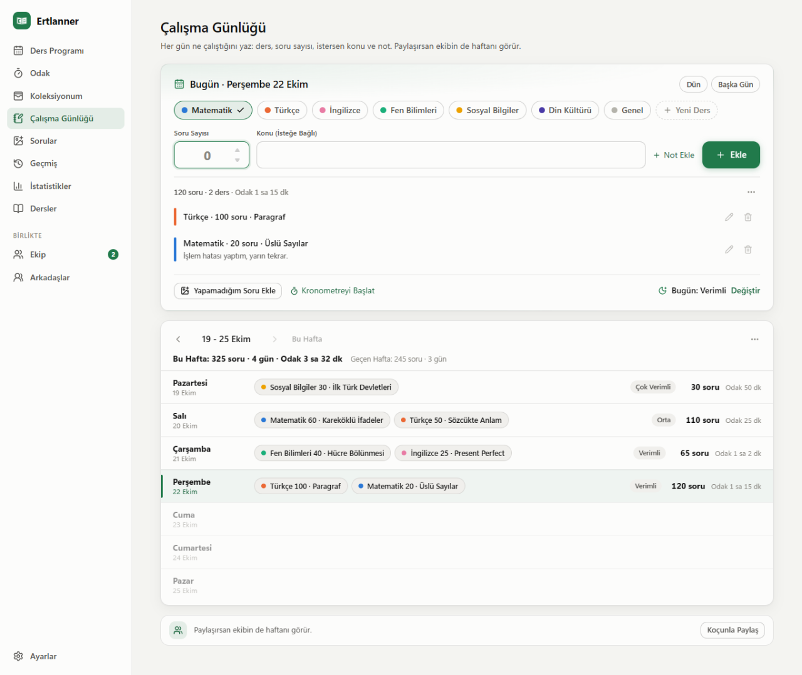

  

<h1 align="center">Ertlanner</h1>

Öğrenciler ve genç profesyoneller için kişisel planlayıcı. Windows ve macOS’ta çalışır.

  

<a href="README.md">English</a> · <b>Türkçe</b>

Ertlanner ders programını, odak seanslarını ve çalışma notlarını tek yerde toplar. Arayüz Türkçe.

## İndirme

En son sürümü [Releases sayfasından](https://github.com/ErtugrulS32175/ertlanner-releases/releases/latest) indir. Tek dosya yeterli:

| Bilgisayar | Dosya |
| --- | --- |
| Windows 10 veya 11, 64 bit | `Ertlanner-Setup-<sürüm>.exe` |
| Apple silicon (M1 ve sonrası) Mac, macOS 13+ | `Ertlanner-<sürüm>-arm64.dmg` |
| Intel Mac, macOS 13+ | `Ertlanner-<sürüm>-x64.dmg` |

Diğer dosyalar (`.blockmap`, `.zip`, `.sig`, `latest*.yml`) güncelleme içindir, indirmen gerekmez.

### İlk Açılış

- **Windows:** SmartScreen yayımcının bilinmediğini söyler. **Ek bilgi**, sonra **Yine de çalıştır** düğmesine tıkla.
- **macOS:** uygulama engellenirse **Sistem Ayarları > Gizlilik ve Güvenlik** bölümünde **Yine de Aç** düğmesine tıkla. Bunu bir kez yapman yeterli.

Sonrasında Windows güncellemeleri arka planda indirir, imzasını denetler ve uygulamadan çıktığında kurar. Mac’te uygulama yeni sürüm çıktığında haber verir.

## Neler Var

- Haftalık ders programı. Tek bir haftaya özel ders ekleyebilir, Google Takvim toplantılarını da görebilirsin (yalnızca okunur).
- Odak zamanlayıcısı. En az 10 dakikalık her tamamlanmış seans, dokuz resimli koleksiyondan birinden kart kazandırır. Seans uzadıkça kart nadirleşir: Ahşap (10 dakika), Bronz, Gümüş, Altın, Elmas, Titanyum (2 saat). Kartlarda puan yok.
- Çalışma Günlüğü: her gün ders başına çözdüğün soru sayısı, konu ve not. Yapamadığın soruları fotoğrafıyla kaydedip sonra tekrar edebilirsin.
- Geçmiş, istatistikler ve günün sonunda yalnızca senin gördüğün Günü Bitir değerlendirmesi.
- Okul ya da Üniversite Ve Profesyonel görünümü. Okul görünümü CV, staj ve proje sayfalarını gizler. Üniversite görünümünde CV ve transkript arşivi, yurt dışı staj başvurusu takibi ve haftalık görevli projeler var.
- İsteğe bağlı Google girişiyle kendi bilgisayarların arasında eşitleme. Veriler kendi Google Drive’ındaki gizli uygulama klasöründe durur.
- İsteğe bağlı Ekip: e-postayla davet ettiğin kişilerle haftalık programı ve çalışma günlüğünü paylaş, geri bildirim ver, sohbet et, birini koç olarak işaretle. Okul görünümünde arkadaş ekleyip haftalık odağı karşılaştırabilir, koleksiyonları paylaşabilirsin.

## Gizlilik

Eşitlemeyi ya da Ekip’i açana kadar verilerin yalnızca bilgisayarında durur. Ayrıntılar [gizlilik politikasında](https://ertugruls32175.github.io/ertlanner-site/privacy/).

## Bu Depo Hakkında

Bu depoda yalnızca kurulum ve güncelleme dosyaları var, kaynak kod gizli. Hata ve önerilerin için [ertlanner-site](https://github.com/ErtugrulS32175/ertlanner-site/issues) deposunda bir issue aç.
